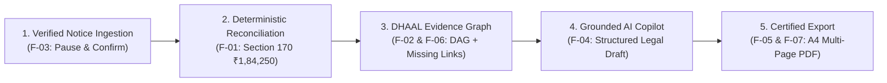

# DHAAL 2.0 — IMPLEMENTATION ROADMAP & PRIORITIZATION
**Phased Engineering Sequence, Feature Impact Scoring & Risk Mitigation Matrix**

**Version:** 2.0.0-PROD-PLAN  
**Status:** Canonical Engineering Specification  
**Strategy:** Minimum Viable Winner (MVW) $\longrightarrow$ Production Hardening $\longrightarrow$ Enterprise General Availability  

---

## 1. Feature Prioritization Matrix

Every proposed capability is ranked across six objective dimensions:
- **Judging Impact:** Visual clarity, technical credibility, domain depth, innovation (1 = Negligible, 10 = Decisive Winning Feature).
- **Technical Complexity:** Algorithmic difficulty, architectural footprint (1 = Trivial, 10 = Research Grade).
- **Implementation Risk:** Probability of breaking changes or demo instability (Low, Medium, High).
- **Dependencies:** Pre-requisite modules or services.
- **Estimated Effort:** Engineering person-hours.
- **Measurable Acceptance Criteria:** Concrete testable condition.

| # | Feature / Capability | Judging Impact (1-10) | Tech Complexity (1-10) | Risk | Dependencies | Effort (Hours) | Measurable Acceptance Criteria |
|:---|:---|:---:|:---:|:---:|:---|:---:|:---|
| **F-01** | **Section 170 CGST Precision Kernel** | **9** | 4 | Low | None | 6 | 24 invoices sum to exact ₹1,84,250; ₹0.00 delta. All tests pass. |
| **F-02** | **DHAAL Evidence Graph (DEG) Canvas** | **10** | 7 | Med | F-01 | 18 | Interactive SVG/WebGL graph rendering nodes and Section 16(2) edges. |
| **F-03** | **Extraction Pause & Human Confirmation** | **8** | 3 | Low | None | 4 | User verifies DIN & amount before triggering reconciliation. |
| **F-04** | **Pydantic Structured Response Copilot** | **9** | 6 | Med | F-01, F-02 | 12 | Pre-flight verification asserts zero numerical drift or fake citations. |
| **F-05** | **Zero-Clipping Multi-Page A4 PDF Export** | **9** | 5 | Low | None | 8 | Multi-page PDF exports cleanly in EN, HI, MR with zero right-edge clipping. |
| **F-06** | **Section 16(2) Missing Link Detector** | **9** | 5 | Low | F-02 | 8 | Flags missing Section 16(2)(c) supplier proof; suggests Circular 183. |
| **F-07** | **Multi-Lingual Tax Glossary (HI/MR)** | **8** | 4 | Low | None | 6 | Instant UI toggle; Devanagari renders with 100% glyph accuracy. |
| **F-08** | **Tamper-Evident Hash-Chained Audit Trail**| **7** | 4 | Low | F-01 | 6 | SHA-256 event chaining visible in UI timeline. |
| **F-09** | **Magic-Byte PDF Sanitizer Middleware** | **6** | 3 | Low | None | 4 | Rejects non-PDFs and PDFs containing embedded JS/executables. |
| **F-10** | **Multi-Tenant PostgreSQL RLS & KMS** | **5** | 8 | High | All | 24 | Schema migrations with row-level security. *(Post-Demo)* |
| **F-11** | **Automated ClamAV Daemon Ingestion** | **4** | 7 | Med | F-09 | 16 | Containerized virus scan pipeline. *(Post-Demo)* |

---

## 2. The Minimum Viable Winner (MVW) Core Feature Set

For a competition-ready hackathon presentation, building excessive enterprise scaffolding (e.g. Stripe billing, multi-organization tenant hierarchies, SSO) distracts from the core domain innovation and increases failure probability.

The **Minimum Viable Winner (MVW)** consists strictly of features **F-01 through F-07**:



### Why this core set wins:
1. **Solves a Real High-Value Pain:** CAs and taxpayers immediately recognize Form ASMT-10 and Section 16(2) disputes.
2. **Defeats the "AI Wrapper" Criticism:** Demonstrates deterministic math, an explicit Evidence Graph, and a pre-flight verification engine that catches LLM drift.
3. **Flawless Visual Execution:** Dual-canvas scan viewer, interactive SVG graph, and publication-grade multi-page PDF export.
4. **Zero-Latency Execution:** Runs seamlessly on local machine and Vercel serverless with sub-second response times.

---

## 3. Four-Phase Phased Implementation Roadmap

```
┌─────────────────────────────────────────────────────────────────────────────────┐
│ PHASE 1: RECONCILIATION & NUMERICAL INTEGRITY HARDENING (CURRENT STATE)        │
│ Timeline: Completed ✅                                                           │
│ Focus: Financial precision, Section 170 compliance, deadline edge cases         │
└─────────────────────────────────────────────────────────────────────────────────┘
  ├── [x] Implement Section 170 Round-Half-Up in Python Decimal & TypeScript
  ├── [x] Fix Invoice 24 discrepancy bug; ensure 24 invoices sum to exact ₹1,84,250
  ├── [x] Harden deadline logic (Expired, Due Today, Critical, Warning, Normal)
  ├── [x] Add prominent 'DEMO DATA / SAMPLE NOTICE' badges to prevent confusion
  └── [x] Build multi-page A4 PDF export with zero right-edge clipping

┌─────────────────────────────────────────────────────────────────────────────────┐
│ PHASE 2: THE DHAAL EVIDENCE GRAPH & SECTION 16(2) MATRIX (IMMEDIATE NEXT)        │
│ Timeline: Phase 2 Hackathon Sprint (24 - 36 Hours)                              │
│ Focus: Visual DAG canvas, missing link detection, Circular 183 grounding        │
└─────────────────────────────────────────────────────────────────────────────────┘
  ├── [ ] Build in-memory Evidence Graph DAG data structure in Python backend
  ├── [ ] Implement interactive Evidence Graph visualization canvas in React
  ├── [ ] Add Section 16(2) Evidentiary Strength Scorecard (0–100%)
  ├── [ ] Implement automated missing evidence detection (e.g. missing 16(2)(c) proof)
  └── [ ] Add inline citation pill linking between legal draft and evidence nodes

┌─────────────────────────────────────────────────────────────────────────────────┐
│ PHASE 3: STRUCTURED AI COPILOT & PRE-FLIGHT VERIFIER                           │
│ Timeline: Phase 3 Hackathon Sprint (16 - 24 Hours)                              │
│ Focus: Gemini 1.5 Pro structured outputs, Pydantic guardrails, zero hallucination│
└─────────────────────────────────────────────────────────────────────────────────┘
  ├── [ ] Bind Gemini 1.5 Pro to strict Pydantic v2 schemas (`LegalDraftSchema`)
  ├── [ ] Build deterministic pre-flight AST verifier checking amounts & citations
  ├── [ ] Integrate immutable GST judicial precedent whitelist
  ├── [ ] Add multi-lingual tax glossary translations for Hindi and Marathi
  └── [ ] Build zero-LLM deterministic Jinja2 fallback template engine

┌─────────────────────────────────────────────────────────────────────────────────┐
│ PHASE 4: ENTERPRISE TENANCY, SECURITY & PRODUCTION GA                           │
│ Timeline: Post-Hackathon Commercialization (3 - 6 Weeks)                        │
│ Focus: Auth0 / Clerk Auth, PostgreSQL RLS, AWS KMS, ClamAV, SOC-2 readiness     │
└─────────────────────────────────────────────────────────────────────────────────┘
  ├── [ ] Implement JWT / RBAC with CA Approver MFA requirements
  ├── [ ] Migrate in-memory session state to PostgreSQL with Row-Level Security
  ├── [ ] Integrate ClamAV malware scanning daemon for cloud file uploads
  ├── [ ] Implement AES-256-GCM envelope encryption with per-tenant KMS keys
  └── [ ] Formal SOC-2 Type II and ISO 27001 compliance audit
```

---

## 4. Anti-Patterns: What NOT to Build for the Hackathon

To maintain velocity and prevent presentation disasters, the team must actively resist these tempting distractions:

- ❌ **Do NOT build a Custom Blockchain for Audit Logs:** Standard SHA-256 hash chaining stored in database rows is faster, cheaper, and more credible to technical judges.
- ❌ **Do NOT build a Full Billing / Subscription Engine:** Mock user tiers or free trials; judges evaluate product value, not Stripe webhook integration.
- ❌ **Do NOT integrate heavy distributed Graph Databases (Neo4j / Amazon Neptune):** For a 50–500 node graph per case, an in-memory NetworkX/Python DAG provides sub-10ms response times without server ops.
- ❌ **Do NOT build an unconstrained Chatbot Assistant:** Conversational chat invites unpredictability, prompt injection, and hallucinations. A structured legal editor with pre-flight checks is far more professional.

---

## 5. Risk Assessment & Technical Mitigation Strategies

| Technical Risk | Probability | Severity | Mitigation Strategy |
|:---|:---:|:---:|:---|
| **External LLM Latency or 429 Quota Exceeded during Live Demo** | High | High | Implement zero-latency local fallback: pre-compiled deterministic Jinja2 rule templates that render instantly. |
| **Inaccurate OCR on Poorly Scanned User Notices** | Med | High | The Extraction Pause Screen (`#confirm`) enforces human-in-the-loop sign-off before downstream math. |
| **Devanagari Font Rendering Glitches on PDF Export** | Med | Med | Pre-load certified Noto Sans Devanagari WOFF/TTF glyphs directly in html2canvas/jsPDF; verified via automated test script. |
| **Browser Out-of-Memory on Large Excel Ingestion** | Low | High | Enforce server-side streaming chunk parser; cap client-side table rendering with virtualized DOM rows. |
| **Accidental Leaking of Secrets in Client Bundles** | Low | High | Automated pre-commit hooks (`git-secrets`); all API keys isolated in backend environment variables. |

---

## 6. Implementation Readiness Sign-Off

The architecture, API contracts, data models, AI specifications, security plans, demo scripts, and roadmaps documented across DHAAL 2.0 establish an executable, low-risk blueprint. 

Every component can be introduced incrementally while preserving the existing, tested codebase on branch `ui/declutter`.
