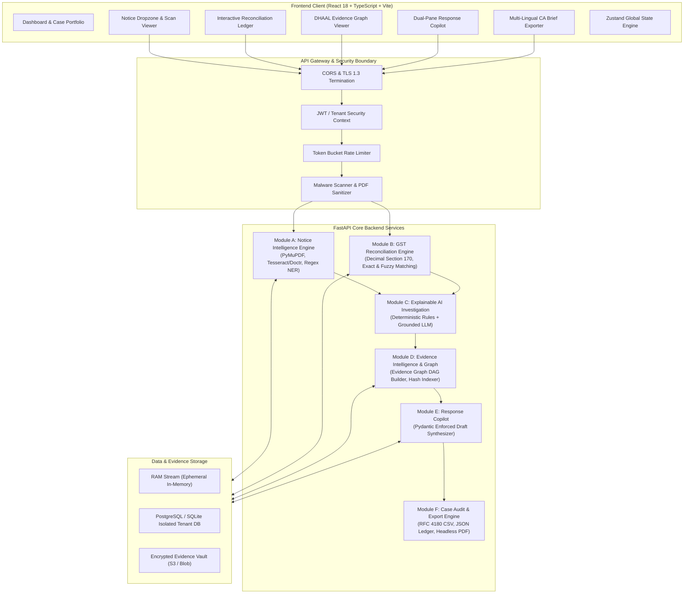

# DHAAL 2.0 — PRODUCT ARCHITECTURE & SYSTEM BLUEPRINT
**GST Scrutiny Intelligence & Evidentiary Defense Platform**

**Version:** 2.0.0-PROD-ARCH  
**Status:** Canonical Engineering Specification  
**Domain:** Indian LegalTech & FinTech (Central Goods and Services Tax Act, 2017)  
**Target Forms:** Form GST ASMT-10, DRC-01A, DRC-01, GSTR-3B vs GSTR-2B (Rule 36(4), Circular 183/15/2022-GST)  
**Target Persona:** Chartered Accountants (CAs), Tax Advocates, CFOs, Tax Practitioners, MSME Taxpayers  

---

## 1. Executive Summary & Architectural Vision

DHAAL (ढाल — "The Shield") 2.0 evolves from a single-case notice explainer into an enterprise-grade **GST Scrutiny Intelligence & Evidentiary Defense Platform**. When a taxpayer receives a statutory notice under Section 61 (Form GST ASMT-10), tax authorities allege discrepancies—predominantly Input Tax Credit (ITC) mismatches between outward returns filed by suppliers (GSTR-2B / GSTR-2A) and ITC availed by the recipient in monthly summary returns (GSTR-3B).

The core technical failure in traditional compliance software is two-fold:
1. **Unverified Financial Hallucination:** Generic LLMs invent invoice numbers, create fictional case law citations, and generate arithmetic that violates statutory rounding rules (e.g. Section 170 of the CGST Act).
2. **Disconnected Evidence Silos:** Invoices, e-way bills, bank payment UTRs, and transport challans exist in scattered folders, detached from the legal assertions drafted in the reply.

**DHAAL 2.0 introduces the DHAAL Evidence Graph (DEG):** a deterministic, directed acyclic bipartite graph that binds statutory notice allegations to physical invoices, banking proofs, reconciliation delta rows, and verified legal propositions.

```
       [Form ASMT-10 Notice Allegation]
                       │
             (Statutory Ground)
                       ▼
       [Deterministic Reconciliation Delta]
          ┌────────────┴────────────┐
          ▼                         ▼
   [24 Invoices in 3B]     [0 Invoices in 2B]
          │                         │
   (Section 16(2)(a))        (Sec 16(2)(c))
          ▼                         ▼
   [Physical Invoice]       [Supplier DRC-03]
          │                         │
   (Sec 16(2) Proviso 2)    (Rule 36(4) / Cir 183)
          ▼                         ▼
  [Bank NEFT/RTGS UTR]      [CA Verification Certificate]
```

### The 4 Architectural Tenets of DHAAL 2.0
1. **Deterministic Financial Kernel:** AI never performs arithmetic or tax reconciliation. All sums, tax differentials, Section 170 rounding, and rule tolerances execute in pure Python/TypeScript algorithms.
2. **Evidence-Grounded Generative Layer:** AI acts strictly as an analytical synthesizer and drafting copilot. Every assertion in a generated brief must carry a cryptographic URI pointer to a verified source artifact.
3. **Statutory Time-Window Enforcement:** Notices are time-gated by Section 61(3) and Rule 99(1). All system states maintain strict statutory countdowns (Normal, Warning, Critical, Due-Today, Expired).
4. **Zero-Persistence Ephemeral Option:** Full capability to operate in RAM-only stream mode for confidential client disclosures, backed by encrypted tenant-isolated storage for persistent team workspaces.

---

## 2. High-Level System Architecture

DHAAL 2.0 retains the efficient, lightweight foundation of **React 18 + Vite + TypeScript + Tailwind CSS** on the frontend, and **FastAPI + Python 3.11+ + Pydantic v2** on the backend, optimized for low-latency Vercel Serverless deployments and high-volume local or containerized execution.



---

## 3. Deep Architectural Specification of the 6 Core Modules

```
┌──────────────────────────────────────────────────────────────────────────────────┐
│                             MODULE A: NOTICE INTELLIGENCE                         │
└──────────────────────────────────────────────────────────────────────────────────┘
```

### 1. Responsibilities
- Ingest physical scans and digitally generated PDFs of Form GST ASMT-10, DRC-01A, and DRC-01.
- Perform optical layout analysis, boundary detection, and multi-pass OCR on smudged or skewed text.
- Extract canonical statutory metadata: Notice ID (DIN/ARN), Section code, Tax Period, Issuing Jurisdiction, Officer Designation, Discrepancy Tables, and Statutory Reply Deadlines.
- Cross-validate OCR extraction using confidence scoring and dual-pass validation.

### 2. Inputs & Outputs
- **Inputs:** `multipart/form-data` PDF/TIFF/JPEG (max 15MB).
- **Outputs:** `NoticeDocumentModel` containing structured metadata, bounding box coordinates, extraction confidence scores (0.00–1.00), and raw table matrices.

### 3. Frontend Components
- `NoticeDropzone.tsx`: Drag-and-drop zone with client-side magic-byte inspection.
- `NoticeScanViewer.tsx`: Dual-canvas split viewer displaying the physical notice alongside extracted bounding boxes and high-contrast zoom lenses for smudged values.
- `NoticeConfirmationModal.tsx`: Field-by-field verification panel requiring user sign-off on unconfirmed or low-confidence extractions.

### 4. Backend Services
- `PdfTextExtractor`: Native text extractor using PyMuPDF (`fitz`) for digital PDFs.
- `OcrFallbackEngine`: PyTesseract / docTR for scanned documents with grayscale thresholding and deskewing.
- `StatutoryEntityRecognizer`: Deterministic regex and NLP entity extractor tuned for CBIC statutory patterns (e.g., DIN formats `ZA[0-9]{12}[A-Z]`, GSTINs `[0-9]{2}[A-Z]{5}[0-9]{4}[A-Z]{1}[1-9A-Z]{1}Z[0-9A-Z]{1}`).

### 5. API Endpoints
- `POST /api/v2/notice/extract`: Uploads notice and executes multi-pass OCR/extraction.
- `GET /api/v2/notice/{notice_id}`: Retrieves parsed metadata and extraction provenance.
- `PUT /api/v2/notice/{notice_id}/confirm`: Submits verified field overrides.

### 6. Data Models & Validation Rules
- Validates GSTIN checksum using statutory modulo 36 check character algorithm.
- Rejects non-GST documents, expired notices lacking valid DIN, or files exceeding page limits.
- Model: `NoticeMetadata` (see `DHAAL_2_DATA_MODEL.md`).

### 7. Error Handling & Security
- Detects PDF bombs, malicious embedded JavaScript, and corrupted streams.
- Rejects encrypted or password-protected PDFs with user-actionable error: `NOTICE_PASSWORD_PROTECTED`.
- Strips EXIF metadata and enforces ephemeral file cleanup immediately post-parsing.

### 8. Automated Tests
- Unit tests for DIN/GSTIN extraction regex.
- Integration tests against synthetic ASMT-10 forms with known skew, smudges, and rotated scans.
- Accuracy benchmark: >98% character recognition on synthetic sample notice set.

### 9. Dependencies
- Dependent on: Common Security & Validation Middleware.
- Feeds into: Module B (Reconciliation), Module C (Investigation), Module F (Audit Trail).

---

```
┌──────────────────────────────────────────────────────────────────────────────────┐
│                          MODULE B: GST RECONCILIATION ENGINE                     │
└──────────────────────────────────────────────────────────────────────────────────┘
```

### 1. Responsibilities
- Ingest outward supplier records (GSTR-2B JSON / Excel) and internal purchase registers (Books / ERP).
- Execute 100% deterministic, two-tier matching algorithms:
  - Tier 1: Exact Match (GSTIN + Normalized Invoice No + Taxable Amount + CGST + SGST + IGST).
  - Tier 2: Fuzzy Match with Explainable Criteria (Transposed digits, date formatting variances, prefix/suffix stripping, invoice number substring matches).
- Classify discrepancies into statutory categories:
  1. *Unreported in 2B* (Supplier failed to file GSTR-1).
  2. *Delayed Filing* (Supplier filed GSTR-1 after monthly cutoff; ITC reflects in subsequent period).
  3. *Rate/Classification Mismatch* (e.g. 18% vs 12% or IGST vs CGST+SGST).
  4. *Cancelled Supplier* (Supplier GSTIN inactive on date of transaction).
- Enforce Section 170 rounding rules (50 paise or more rounds UP to the nearest rupee).

### 2. Inputs & Outputs
- **Inputs:**
  - Recipient Purchase Register (CSV / XLSX / JSON).
  - Auto-populated GSTR-2B Statement (Govt JSON / CSV).
  - Notice Questioned ITC Amount (from Module A).
- **Outputs:**
  - `ReconciliationRunResult`: Classified line-item ledger, summary variances, exact matches, probable matches, and unmapped variance.

### 3. Frontend Components
- `ReconciliationLedgerTable.tsx`: Virtualized data table (supporting 10,000+ rows) with multi-column filtering, sort, and status badges.
- `MatchReviewModal.tsx`: Visual diff card comparing ERP invoice vs GSTR-2B record with confidence score and human override buttons.
- `VarianceSummaryCard.tsx`: Real-time statutory balance card verifying whether itemized line differences equal the notice demand down to ₹0.00.

### 4. Backend Services
- `InvoiceNormalizer`: Strips legal entity suffixes (Pvt Ltd, LLC), removes leading zeroes/symbols (`INV-0012` -> `12`), formats dates to ISO-8601.
- `DeterministicReconciliationEngine`: Exact hash matcher utilizing compound keys: `SHA256(supplier_gstin + normalized_inv_no)`.
- `FuzzyScoringEngine`: Levenshtein distance on invoice numbers, Date difference tolerance window ($\pm 30$ days), and Tax amount tolerance ($\le \text{₹}10$ rounding).

### 5. API Endpoints
- `POST /api/v2/reconciliation/run`: Uploads registers and triggers reconciliation.
- `GET /api/v2/reconciliation/{reconciliation_id}/rows`: Returns paginated reconciled rows.
- `POST /api/v2/reconciliation/{reconciliation_id}/override`: Manual CA match approval.
- `GET /api/v2/reconciliation/{reconciliation_id}/export/csv`: RFC 4180 compliant CSV export.

### 6. Data Models & Validation Rules
- All rupee amounts stored as fixed integers or `Decimal(12, 2)`. No floating-point math.
- Total explained variance + unexplained delta must equal `NoticeMetadata.discrepancy_amount`.
- Model: `ReconciliationLedger`, `InvoiceRecord` (see `DHAAL_2_DATA_MODEL.md`).

### 7. Error Handling & Security
- Validates CSV/Excel schemas; rejects missing required headers with row/column pointer.
- Memory protection: Streaming chunk parser prevents Out-Of-Memory (OOM) on 100k-row files.

### 8. Automated Tests
- Golden dataset testing with 50 synthetic invoices containing deliberate misspellings, trailing zeros, date swaps, and rounding errors.
- Decimal precision invariant tests.

### 9. Dependencies
- Dependent on: Module A (Questioned ITC demand target).
- Feeds into: Module C (Investigation), Module D (Evidence Graph), Module E (Response Copilot).

---

```
┌──────────────────────────────────────────────────────────────────────────────────┐
│                     MODULE C: EXPLAINABLE AI INVESTIGATION LAYER                 │
└──────────────────────────────────────────────────────────────────────────────────┘
```

### 1. Responsibilities
- Analyze discrepancy root causes by synthesizing statutory rules, circulars, and judicial precedents.
- Apply statutory rule trees:
  - If discrepancy is due to supplier late filing: Apply **CBIC Circular No. 183/15/2022-GST** and **Circular No. 193/05/2023-GST**.
  - If discrepancy is due to bona-fide recipient holding tax invoice and bank payment: Apply landmark jurisprudence (*Union of India v. Bharti Airtel Ltd*, *D.Y. Beathel Enterprises v. State Tax Officer*).
- Formulate a clear, layman-accessible explanation in English, Hindi, and Marathi.
- Calculate statutory deadlines and response strategies under Section 61(3).

### 2. Inputs & Outputs
- **Inputs:** Reconciled discrepancies from Module B, Notice metadata from Module A.
- **Outputs:** `InvestigationAnalysis`: Categorized root causes, applicable statutory circulars, procedural rights summary, recommended defense strategies, and missing document requirements.

### 3. Frontend Components
- `RootCauseInsightCard.tsx`: Interactive card breaking down the ₹1,84,250 discrepancy into legal buckets.
- `StatutoryCircularBanner.tsx`: Highlights applicable CBIC guidelines (e.g. CA Certificate threshold > ₹5 Lakh vs Supplier Declaration $\le$ ₹5 Lakh).
- `LanguageSwitchBar.tsx`: Real-time toggle switching explainer between English, Hindi (हिंदी), and Marathi (मराठी).

### 4. Backend Services
- `StatutoryRuleTree`: Deterministic decision tree mapping conditions to legal citations.
- `ExplainableAiService`: Grounded LLM agent (Gemini 1.5 Pro / Flash via structured outputs) with strict zero-hallucination prompt constraints.
- `MultiLingualTranslator`: Translates explanations using localized tax glossaries (preventing mistranslation of terms like "Input Tax Credit" or "Reversal").

### 5. API Endpoints
- `POST /api/v2/investigation/analyze`: Evaluates reconciled notice and generates findings.
- `GET /api/v2/investigation/{notice_id}/strategy`: Returns recommended defense posture.

### 6. Data Models & Validation Rules
- All legal recommendations must match one of 5 statutory taxonomies: `GENUINE_SUPPLIER_DEFAULT`, `TIMING_DIFFERENCE`, `CLERICAL_ERROR`, `WRONG_HEAD_AVAILMENT`, `EXEMPT_TRANSACTION`.
- Pydantic validator guarantees no unstructured string outputs; must conform to `InvestigationReportSchema`.

### 7. Error Handling & Security
- Fallback to pure deterministic template explanations if LLM endpoint encounters timeout or quota degradation.
- Zero client-identifying data transmitted to external inference APIs without tenant redaction.

### 8. Automated Tests
- Test cases verifying that claims exceeding ₹5 Lakh demand require CA certificate with UDIN, while $\le$ ₹5 Lakh accept supplier CA/declaration per Circular 183.
- Output validation asserting zero occurrences of non-existent sections (e.g., "Section 16(5)" before Finance Act 2024 amendments).

### 9. Dependencies
- Dependent on: Module A & Module B.
- Feeds into: Module D (Evidence Graph) & Module E (Response Copilot).

---

```
┌──────────────────────────────────────────────────────────────────────────────────┐
│                       MODULE D: EVIDENCE INTELLIGENCE LAYER                      │
│                           (THE DHAAL EVIDENCE GRAPH)                             │
└──────────────────────────────────────────────────────────────────────────────────┘
```

### 1. Responsibilities
- Construct and maintain the **DHAAL Evidence Graph (DEG)**: a cryptographic bipartite graph linking:
  $$\text{Notice Allegation} \longrightarrow \text{Reconciliation Row} \longrightarrow \text{Physical Document} \longrightarrow \text{Banking Trail} \longrightarrow \text{Statutory Section}$$
- Compute the **Evidentiary Strength Score (ESS)** (0–100%) for every line item based on fulfillment of the four mandatory conditions of Section 16(2) of the CGST Act:
  1. $\text{Condition 16(2)(a)}$: Possession of tax invoice / debit note.
  2. $\text{Condition 16(2)(b)}$: Physical receipt of goods/services (E-Way Bill / Transport GR).
  3. $\text{Condition 16(2)(c)}$: Tax actually paid to government (Supplier GSTR-3B / DRC-03 / Circular 183 certificate).
  4. $\text{Condition 16(2)(d)}$: Recipient furnished return under Section 39 (GSTR-3B filing acknowledgement).
  5. $\text{Proviso 2 to 16(2)}$: Payment of value + tax within 180 days (Bank UTR / Bank Statement).
- Detect and flag missing links (e.g., invoice present, bank payment verified, but supplier tax payment proof missing).

### 2. Inputs & Outputs
- **Inputs:** Invoices, Bank Statements, E-Way Bills, Supplier Declarations, Circular 183 Certificates.
- **Outputs:**
  - `EvidenceGraphTopology`: Nodes (Entities) and Edges (Verifications).
  - `EvidentiaryScorecard`: Section 16(2) audit matrix and unlinked evidence alerts.

### 3. Frontend Components
- `EvidenceGraphCanvas.tsx`: Interactive SVG/WebGL diagram showing nodes (Notice $\to$ Invoice $\to$ Bank $\to$ Law) with zoom, pan, and filter.
- `Section16AuditMatrix.tsx`: 5-column compliance grid showing green checkmarks and red caution indicators for each statutory clause.
- `EvidenceUploadModal.tsx`: Smart uploader that auto-extracts UTRs from bank PDFs and matches them to invoice amounts.

### 4. Backend Services
- `EvidenceGraphBuilder`: In-memory DAG orchestrator computing node degrees, path completeness, and reachability.
- `BankStatementParser`: Extracts date, UTR, beneficiary name, and debit amount from bank statement PDFs/CSV.
- `EwayBillMatcher`: Matches E-Way bill 12-digit numbers to invoice numbers and dates.

### 5. API Endpoints
- `GET /api/v2/evidence/{case_id}/graph`: Returns graph topology JSON for frontend rendering.
- `POST /api/v2/evidence/{case_id}/attach`: Links an uploaded evidence file to specific reconciliation rows.
- `GET /api/v2/evidence/{case_id}/scorecard`: Computes Section 16(2) Evidentiary Strength Score.

### 6. Data Models & Validation Rules
- Graph acyclicity: Enforces no circular dependencies between evidence items.
- Edge validation: An edge between `InvoiceNode` and `BankNode` requires either exact amount match or invoice amount $\le$ bulk payment amount.
- Model: `EvidenceGraphNode`, `EvidenceEdge`, `EvidentiaryScorecard`.

### 7. Error Handling & Security
- Hash verification: Every uploaded document node stores its `SHA-256` content hash. If file bytes change, edges invalidate immediately.
- PII Masking: Redacts non-relevant bank ledger transactions to protect taxpayer financial privacy.

### 8. Automated Tests
- Graph completeness unit tests verifying 100% ESS when all 5 statutory legs are attached.
- Graph traversal tests detecting broken links when an invoice is unlinked from a payment proof.

### 9. Dependencies
- Dependent on: Module B (Reconciliation Rows) & Module C (Statutory Requirements).
- Feeds into: Module E (Response Copilot) & Module F (Brief Exporter).

---

```
┌──────────────────────────────────────────────────────────────────────────────────┐
│                            MODULE E: RESPONSE COPILOT                            │
└──────────────────────────────────────────────────────────────────────────────────┘
```

### 1. Responsibilities
- Synthesize a formal, legally structured reply to Form GST ASMT-10 addressed to the proper adjudicating officer.
- Ground every factual assertion in nodes from the DHAAL Evidence Graph.
- Enforce strict template architecture:
  - Part I: Preliminary Submissions & Taxpayer Profile.
  - Part II: Factual Background & Transaction Matrix.
  - Part III: Statutory Submissions & Itemized Defense (Rule 36(4), Circular 183/193).
  - Part IV: Jurisprudential Grounding (High Court / Supreme Court precedents).
  - Part V: Summary of Annexures (referencing Evidence Graph artifacts).
  - Part VI: Formal Prayer for Drop of Proceedings under Section 61(2).
- Execute deterministic pre-submission verification (re-verifying amounts, sections, and dates).

### 2. Inputs & Outputs
- **Inputs:** Evidence Graph topology, Reconciliation Ledger, Case Metadata, User-selected Tone (Conciliatory, Assertive, Technical).
- **Outputs:** `StructuredReplyDraft`: Editable multi-section reply with inline evidentiary citations and annexure cross-references.

### 3. Frontend Components
- `DualPaneEditor.tsx`: Split screen featuring the generated legal draft on the left and dynamic Evidence Cards on the right.
- `CitationPill.tsx`: Clickable inline pill in the legal draft that jumps directly to the linked invoice or bank UTR in the Evidence Graph.
- `PreFlightVerifierModal.tsx`: Pre-submission checklist verifying that confirmed discrepancy amount equals the draft sum.

### 4. Backend Services
- `DraftSynthesisEngine`: Orchestrates prompt execution using Pydantic structured output parsing with strict temperature 0.0.
- `DraftConsistencyVerifier`: Deterministic verification engine scanning the generated text for numerical, date, and section consistency against `NoticeMetadata`.
- `PrecedentRetriever`: In-memory curated repository of verified GST court rulings (eliminating hallucinated citations).

### 5. API Endpoints
- `POST /api/v2/copilot/generate-draft`: Synthesizes full structured draft.
- `POST /api/v2/copilot/verify-draft`: Performs consistency verification and returns mismatch report.
- `PUT /api/v2/copilot/{case_id}/save-draft`: Stores edited draft sections.

### 6. Data Models & Validation Rules
- Mandatory invariant: The sum of amounts claimed in the draft must equal `NoticeMetadata.discrepancy_amount`.
- Model: `LegalDraftSchema`, `DraftVerifyResponse` (see `DHAAL_2_DATA_MODEL.md`).

### 7. Error Handling & Security
- Prompt injection defense: User-provided invoice remarks or supplier comments are strictly sanitized before passing into LLM context.
- Fallback: Pre-packaged statutory response templates available if LLM API is unavailable.

### 8. Automated Tests
- Verification tests asserting that any mismatch in amount or DIN triggers a `CRITICAL` verification alert.
- Hallucination detection benchmark: 0 unverified citations allowed.

### 9. Dependencies
- Dependent on: Modules A, B, C, and D.
- Feeds into: Module F (CA Brief & Export).

---

```
┌──────────────────────────────────────────────────────────────────────────────────┐
│                   MODULE F: CASE MANAGEMENT & AUDIT TRAIL                        │
└──────────────────────────────────────────────────────────────────────────────────┘
```

### 1. Responsibilities
- Maintain an immutable, append-only chronological log of all case events (Upload, Extraction Confirmation, Reconciliation Overrides, Evidence Attachment, Draft Edits, CA Approval, PDF Export).
- Generate the **CA-Ready Brief**: an exhaustive dossier consolidating Executive Summary, Allegation Matrix, Itemized Invoice Reconciliation, Evidence Graph Scorecard, Legal Reply Draft, and Annexure Checklist.
- Generate pixel-perfect, multi-lingual (EN, HI, MR), multi-page A4 PDF exports with zero text truncation or right-edge clipping.
- Export RFC 4180 CSV reconciliation files for Chartered Accountant working papers.

### 2. Inputs & Outputs
- **Inputs:** Full case state, signed CA verification details (CA Name, Membership Number, Firm Name, UDIN if available).
- **Outputs:**
  - Standardized A4 PDF Brief (`DHAAL_CA_Brief_{NoticeID}.pdf`).
  - Itemized Reconciliation CSV (`DHAAL_Reconciliation_{NoticeID}.csv`).
  - Audit Trail JSON (`DHAAL_AuditTrail_{NoticeID}.json`).

### 3. Frontend Components
- `CaReadyBriefScreen.tsx`: Clean, publication-grade document review view with print preview mode.
- `CaSignOffModal.tsx`: Modal capturing professional sign-off credentials and UDIN disclaimer.
- `AuditTimeline.tsx`: Visual audit trail displaying timestamped user and system actions.

### 4. Backend Services
- `AuditTrailRecorder`: Append-only event logger with hash-chaining (each event hashes the previous event hash, providing tamper-evident integrity).
- `PdfExportService`: Client-side high-fidelity rendering (jsPDF + html2canvas with DPI-aware page splitters) and optional serverless headless Chromium fallback.
- `CsvExportGenerator`: RFC 4180 streaming CSV builder with field quoting and formula injection prevention.

### 5. API Endpoints
- `GET /api/v2/case/{case_id}/audit-trail`: Retrieves complete tamper-evident audit history.
- `POST /api/v2/case/{case_id}/approve`: Submits CA professional approval.
- `GET /api/v2/case/{case_id}/export/brief-pdf`: Server-rendered PDF generator.

### 6. Data Models & Validation Rules
- An unapproved case cannot export a "Final CA Certified Brief" (exports as "Draft / Unverified Brief" watermark).
- Model: `AuditEvent`, `CaSignOffDetails`, `CaseSummary`.

### 7. Error Handling & Security
- CSV formula injection protection: Prepend single quote `'` to any cell value starting with `=`, `+`, `-`, or `@`.
- PDF generation timeout guards and memory limits.

### 8. Automated Tests
- Multi-page page-break tests verifying headers, footers, and table rows do not get sliced mid-text.
- Multi-lingual character set rendering tests (verifying Devanagari Unicode rendering without glyph corruption).

### 9. Dependencies
- Dependent on: All Modules (A through E).
- Feeds into: User Download & Final Tax Authority Filing.

---

## 4. End-to-End System Data Flow

```
[Taxpayer / CA]
      │
      │ 1. Upload Form ASMT-10 PDF
      ▼
[Module A: Notice Intelligence] ────► [Extracts DIN, Period, Discrepancy: ₹1,84,250]
      │                                       │
      │ 2. Confirms Extraction                │
      ▼                                       ▼
[Module B: GST Reconciliation] ◄──── [Ingests GSTR-2B & Purchase Register]
      │
      │ 3. 24 Invoices Matched & Reconciled (Exact: ₹1,84,250; Taxable: ₹10,23,611)
      ▼
[Module C: Explainable AI] ─────────► [Maps to Circular 183 & Timing Differences]
      │
      │ 4. Construct Relationships
      ▼
[Module D: DHAAL Evidence Graph] ───► [Binds Invoices + Bank UTRs + Sec 16(2) Checks]
      │
      │ 5. Generate Grounded Reply
      ▼
[Module E: Response Copilot] ───────► [Drafts Legal Reply with Linked Citations]
      │
      │ 6. CA Sign-Off & Verification
      ▼
[Module F: Audit & Export] ─────────► [Exports Multi-Page PDF Brief + CSV Ledger]
```

---

## 5. Technology Stack Selection Justification

| Layer | Selected Technology | Why Retained & Upgraded | Alternatives Rejected |
|:---|:---|:---|:---|
| **Frontend Framework** | React 18 + Vite 5 + TypeScript | Ultra-fast HMR, lightweight bundle (<300KB gzip), type-safe financial contracts, rapid iteration during hackathon | Next.js / Angular (Unnecessary SSR overhead, heavier server footprint, slower local dev) |
| **State Engine** | Zustand | Zero-boilerplate, high-performance immutable state, simple slice partitioning for all 6 modules | Redux Toolkit (Too verbose), Context API (Unnecessary re-renders on large tables) |
| **Styling** | Tailwind CSS 3.4+ | Utility-first, predictable responsive breakpoints, native print stylesheet support for A4 rendering | CSS Modules / Styled Components (Higher maintenance, heavier runtime) |
| **Backend Framework** | FastAPI (Python 3.11+) | Async native, automatic OpenAPI 3.1 generation, native Pydantic v2 validation, 10x faster than legacy Flask | Flask / Django (Synchronous bottlenecks, heavy ORM bloat not needed for micro-engine) |
| **Data Validation** | Pydantic v2 | Rust-accelerated validation, strict typing, native JSON schema reflection for LLM structured output | Marshmallow / Cerberus (Significantly slower, lacking modern typing) |
| **Financial Math** | Python `Decimal` + TS Integers | Exact Section 170 CGST Act compliance (`ROUND_HALF_UP`), zero floating point drift | IEEE-754 floats (`Math.round` - causes penny rounding failures) |
| **Deployment** | Vercel Serverless | Free tier friendly, instant global CDN, zero-maintenance infrastructure, native Python API integration | AWS ECS / EKS (Cost prohibitive for hackathon, complex ops) |

---

## 6. Architecture Review Checklist

- [x] **No LLM in the Math Path:** Mathematical reconciliation and Section 170 rounding isolated in deterministic modules.
- [x] **Evidence Traceability:** Every allegation mapped to physical invoice, bank UTR, and statutory section via the Evidence Graph.
- [x] **Statutory Soundness:** Fully aligned with Form ASMT-10, Section 61, Section 16(2), and CBIC Circular 183.
- [x] **High-Performance UI:** Capable of handling virtualized tables and SVG graph rendering on standard client machines.
- [x] **Clean Modular Separation:** All six modules communicate via documented REST and JSON interfaces.
