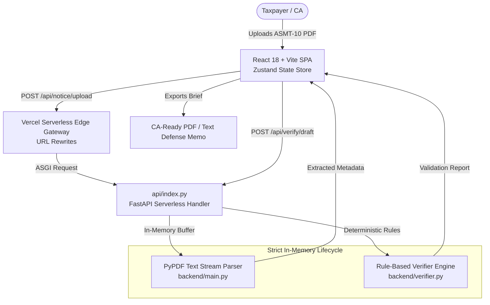

# Dhaal (ढाल) — GST Scrutiny Notice Shield (Form ASMT-10)

> **Statutory drafting aid for professional review. Not legal advice. Final review and submission by a Chartered Accountant required.**

**Dhaal (ढाल)** is a specialized compliance assistant designed to help Indian MSMEs and Chartered Accountants rapidly analyze, verify, and formulate statutory replies to **Form GST ASMT-10** scrutiny notices issued under **Section 61 of the CGST Act, 2017** read with **Rule 99(1)**.

---

## 🎯 The Problem

1. **Short Statutory Response Window:** Section 61 notices typically mandate a written response within **30 days**. Failure to furnish an adequate reply triggers summary assessment orders under Section 73 or 74 with punitive interest and penalties.
2. **Complex ITC Reconciliations:** Taxpayers struggle to reconcile Table 4(A)(5) "All other ITC" in GSTR-3B against auto-populated supplier invoices in GSTR-2B.
3. **Panic & Misinterpretation:** Taxpayers frequently mistake an ASMT-10 scrutiny notice for a final adjudicated tax demand order, resulting in panic rather than timely evidence gathering.

---

## 🛡️ Key Features

- **In-Memory PDF Notice Ingestion:** Parses physical text-searchable ASMT-10 PDF documents to automatically extract the Notice Reference ID, GSTIN, CGST Section, Tax Period, and Questioned Discrepancy Amount without saving files to disk.
- **Deterministic Statutory Verifier (Dual-Layer):** Cross-verifies legal draft responses against confirmed discrepancy figures, statutory sections (Section 61, Section 16(2)), and calendar limitation deadlines using deterministic Python rules—**100% hallucination-free**.
- **Multilingual Plain-Language Explanations:** Translates complex statutory scrutiny terms into plain English, Hindi (हिंदी), and Marathi (मराठी) to help taxpayers understand their exact obligations.
- **Statutory Evidence Checklist:** Pre-populates statutory documentation requirements (tax invoices under Sec 16(2)(a), bank RTGS/NEFT payment proofs under Sec 16(2) second proviso, E-way bills, and Circular 183 supplier declarations).
- **CA-Ready Brief Synthesizer:** Generates a structured defense memo and reconciliation brief ready for Chartered Accountant sign-off.

---

## 🏗️ Architecture



---

## 💻 Tech Stack

- **Frontend:** React 18, Vite, TypeScript, Tailwind CSS, Zustand, Vitest
- **Backend:** Python 3.12, FastAPI, Pydantic v2, PyPDF, Uvicorn, Pytest
- **Deployment:** Unified Serverless Monorepo deployed on Vercel (`vercel.json`)

---

## 🔒 Privacy & Data Handling (Audited)

- **Purely In-Memory Processing:** Uploaded notices are read directly into ephemeral memory (`io.BytesIO`) for parsing and validation. 
- **Zero Disk Retention:** No uploaded documents, temporary files, or parsed records are written to disk, databases, or cloud storage buckets.
- **Zero Third-Party LLM Transmission:** The reconciliation checks, number verifications, and draft mismatch audits are computed entirely with local deterministic Python algorithms—no taxpayer data is transmitted to external AI APIs.
- **Standard Console Logging:** Logs are restricted to basic request metadata (HTTP path, response code, and latency) printed to stdout/stderr. No taxpayer PII is retained in persistent log files.

---

## ⚠️ Known Limitations

- **Text-Layer PDFs Only:** Notice parsing relies on digital text layers within PDFs. Scanned image-only PDFs without OCR text layers are safely rejected with HTTP 422, prompting the user to upload a text-searchable document.
- **Serverless Request Size Limit:** Upload payloads are capped at **4 MB** to operate safely within Vercel's serverless function request body ceiling (4.5 MB).
- **Execution Timeout:** Vercel serverless requests time out after 10 seconds on standard tiers (all in-memory parsing executes within 50ms).

---

## 🗺️ Roadmap

1. **Async OCR Processing:** Background Celery/Redis queue with Optical Character Recognition (Tesseract / Vision AI) for smudged or physical paper notices.
2. **Client Vault with Opt-In Persistence:** End-to-end encrypted local/cloud storage for Chartered Accountants managing multi-year client scrutiny portfolios.
3. **Automated GSTR-2B JSON Import:** Direct JSON ingestion from the GST Portal for automatic reconciliation against inward supply invoices.

---

## 🚀 Local Development Setup

### 1. Prerequisites
- **Node.js** v18+ & **npm** v9+
- **Python** 3.10+ & **pip**

### 2. Backend Setup
```bash
# Navigate to backend directory
cd backend

# (Optional) Create virtual environment
python -m venv venv
# Windows:
.\venv\Scripts\activate
# Linux/macOS:
source venv/bin/activate

# Install runtime dependencies
pip install -r requirements.txt

# Install test dependencies
pip install -r requirements-dev.txt

# Start local FastAPI server on port 8001
uvicorn main:app --port 8001 --reload
```

### 3. Frontend Setup
```bash
# In the repository root
npm install

# Start Vite dev server on port 3001
npm run dev
```
Open [http://localhost:3001](http://localhost:3001) in your browser.

### 4. Running Tests
```bash
# Frontend Unit Tests (Vitest)
npm test

# Backend Tests (Pytest)
python -m pytest backend/tests -v
```

---

## 📸 Screenshots

*(UI walkthrough captures of the 6-stage compliance workflow)*

| Stage 1: Notice Upload & Stream Parsing | Stage 2: Pause & Confirm Scanned Amount |
| :---: | :---: |
| *[Screenshot Placeholder: Stage 1 Notice Upload & Dropzone]* | *[Screenshot Placeholder: Stage 2 Discrepancy Amount Confirmation]* |

| Stage 3: Statutory Deadlines & Explainer | Stage 5: Deterministic Draft Verifier |
| :---: | :---: |
| *[Screenshot Placeholder: Stage 3 Multilingual Statutory Clock]* | *[Screenshot Placeholder: Stage 5 Real-Time Mismatch Audit]* |

---

## ⚖️ Legal Disclaimer

*Dhaal is an assistive compliance drafting aid designed for pre-submission analysis by businesses and Chartered Accountants. It does not file any documents with the GST Common Portal and does not constitute formal legal counsel.*
