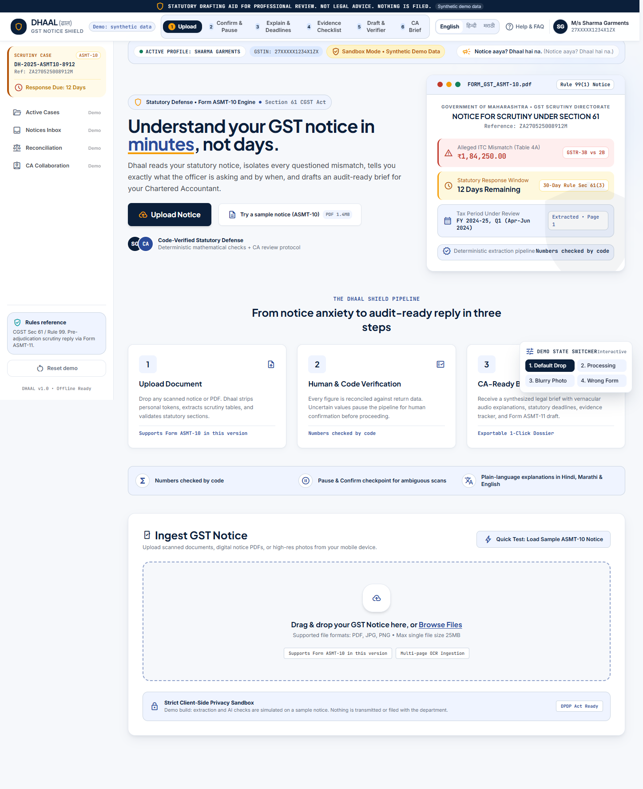
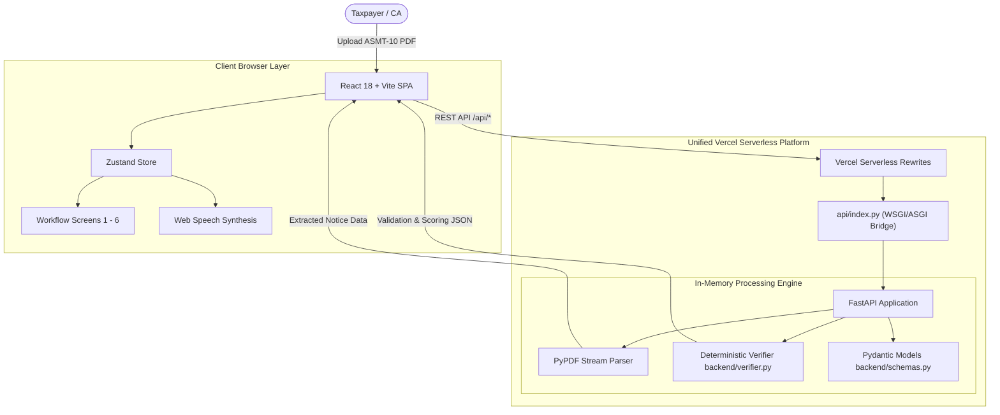

<p align="center">
  
</p>

# Dhaal (ढाल) — GST Scrutiny Notice Shield (Form ASMT-10)

> **Statutory drafting aid for professional review. Not legal advice.**

[](https://dhaal-gst-sheild.vercel.app)
[](./LICENSE)
[](https://react.dev)
[](https://fastapi.tiangolo.com)

Dhaal (ढाल — *Shield*) is a full-stack compliance workspace designed for Chartered Accountants, tax practitioners, and Indian SMEs facing statutory scrutiny notices issued under **Section 61 of the CGST Act** (Form GST ASMT-10). It parses notice parameters, mathematically verifies discrepancies, enforces statutory response deadlines, and produces audit-ready reply drafts in minutes.

---

## 🎯 Live Application & Walkthrough
* **Live Production URL:** [https://dhaal-gst-sheild.vercel.app](https://dhaal-gst-sheild.vercel.app)
* **Judges' 3-Minute Demo Script:** [🎯 Read the Hackathon Demo Guide](./DEMO.md)

---

## 🛡️ Why Dhaal Stands Out (Market Differentiators)
Unlike generic document parsers or basic AI wrappers, Dhaal provides a production-grade statutory compliance shield through:
* **Deterministic + Probabilistic Hybrid Validation:** Combines flexible generative reasoning with strict Python regex/deterministic math checks to eliminate financial hallucinations.
* **Statutory Section Mapping:** Automatically maps identified discrepancies directly to **Section 61 of the CGST Act and Rule 99(1)**.
* **CA-Ready Structured Briefs:** Packages outputs into professional audit summaries optimized for client review and Chartered Accountant handoff.
* **Zero-Retention Privacy Sandbox:** Enterprise-grade security processing sensitive taxpayer records strictly in-memory without persistent third-party database storage.

---
## ⚠️ The Problem: GST ASMT-10 Scrutiny Anxiety
When a taxpayer receives Form GST ASMT-10:
1. **Strict 30-Day Statutory Deadline:** Rule 99(1) of the CGST Rules mandates a response within 30 days. Missing this timeline automatically escalates scrutiny into summary assessments under Section 73 or Section 74.
2. **Discrepancy Complexity:** Notices typically cite mathematical differences between GSTR-3B (outward returns) and GSTR-2A/2B (auto-drafted ITC statements) or e-Way bill logs.
3. **Taxpayer Anxiety & High Cost:** SMEs panic over perceived tax liabilities, while CAs spend hours manually extracting DINs, verifying tax periods, and drafting repetitive legal responses.

---

## 🖼️ Application Walkthrough & Screenshots

| Screen 1: Notice Ingestion & Validation | Screen 2: Parameter Extraction & Pause |
| :---: | :---: |
|  |  |
| *Drag-and-drop PDF ingestion with client/server validation* | *Taxpayer verifies extracted DIN, section & amounts* |

| Screen 3: Statutory Deadlines & Explainer | Screen 4: Evidence Checklist & WA Share |
| :---: | :---: |
|  |  |
| *Statutory countdown timer & plain-English/Hindi explainer* | *Required document checklist with 1-click WhatsApp delegation* |

| Screen 5: Live Draft Verifier | Screen 6: CA-Ready Brief & PDF Export |
| :---: | :---: |
|  |  |
| *Real-time statutory citation & legal validity scoring* | *Comprehensive dossier ready for CA review or submission* |

---

## ✨ Core Features
* **In-Memory Notice Ingestion:** Stream-based PDF text extraction (`pypdf`) extracting Document Identification Numbers (DIN), Reference IDs, taxable periods, and discrepancy amounts.
* **Deterministic Reconciliation Engine:** Rule-based mathematical verification between claimed Input Tax Credit (ITC) and auto-populated ledger records without LLM hallucination risk.
* **Statutory Rule 99(1) Deadline Tracker:** Visual countdown with color-coded risk alerts to ensure zero missed statutory deadlines.
* **Evidence Gathering Assistant:** Itemized documentary checklist (vendor invoices, proof of payment, GSTR-2B reconciliations) shareable directly via WhatsApp to business owners.
* **Real-Time Reply Verifier:** 500ms debounced statutory analysis evaluating defense drafts against required legal citations (Section 61, Rule 99(1), circular references).
* **Multilingual Explainer & Audio Readout:** Plain-language synthesis in English and Hindi with Web Speech vernacular audio synthesis for business owners.

---

## 🏗️ System Architecture & Workflow



---

## ✨ Core Features & Workflow

| Layer | Technologies |
| :--- | :--- |
| **Frontend Framework** | React 18, Vite 5, TypeScript |
| **State Management** | Zustand (persistent state with offline demo mode) |
| **Styling & UI** | Tailwind CSS, Lucide React, Google Material Icons |
| **Backend Framework** | Python 3.11+, FastAPI, Uvicorn |
| **Data Validation** | Pydantic v2 |
| **Document Processing** | PyPDF (in-memory binary streaming) |
| **Deployment** | Vercel Serverless Functions (`api/index.py`) |
| **Testing** | Vitest (Frontend), Pytest (Backend) |

---

## 📁 Project Structure

```
DHAAL/
├── .github/workflows/          # CI/CD pipelines (GitHub Actions)
├── api/                        # Vercel serverless function entrypoint
│   └── index.py                # Imports and routes FastAPI app on Vercel
├── backend/                    # Python FastAPI service
│   ├── main.py                 # REST endpoints (/api/notice/upload, /api/verify/draft, etc.)
│   ├── schemas.py              # Pydantic data schemas
│   ├── verifier.py             # Deterministic verification & legal scoring logic
│   └── tests/                  # Backend unit & integration test suite
├── docs/                       # Technical documentation & screenshots
│   └── screenshots/            # UI walkthrough imagery for desktop and mobile
├── source/                     # Original prototype & design specifications
│   └── stitch_dhaal_.../       # Google Stitch design prototype assets
├── src/                        # React 18 frontend codebase
│   ├── components/             # Reusable UI components (Navbar, Stepper, Badges)
│   ├── screens/                # The 6 core workflow screens
│   ├── store/                  # Zustand state store
│   └── mockApi.ts              # Resilient API client with automatic offline fallback
├── Procfile                    # Alternative deployment config for Render/Railway/Heroku
├── netlify.toml                # Alternative deployment config for Netlify SPA hosting
├── vercel.json                 # Production configuration for Vercel serverless deployment
├── package.json                # Frontend dependencies & scripts
└── requirements.txt            # Python dependencies
```

> **Why alternative deployment files exist:**
> * `vercel.json` is our primary production target, serving both the Vite SPA and Python API on one unified serverless domain.
> * `Procfile` allows the backend to be deployed on container/PaaS platforms (Railway, Render, Heroku) as an independent service.
> * `netlify.toml` provides static SPA rewrite rules if hosted separately on Netlify.
> * `source/stitch_dhaal_gst_notice_assistant` archives the original design assets created during UI prototyping.

---

## 🚀 Running Locally

### Prerequisites
* **Node.js**: v18+ and `npm`
* **Python**: v3.11+ and `pip`

### 1. Backend Setup (FastAPI)
```bash
# From repository root
cd backend

# Create and activate virtual environment
python -m venv .venv
# On Windows (PowerShell):
.venv\Scripts\Activate.ps1
# On macOS/Linux:
source .venv/bin/activate

# Install dependencies
pip install -r ../requirements.txt

# Start backend server on port 8001
uvicorn main:app --reload --port 8001
```

### 2. Frontend Setup (React + Vite)
```bash
# In a separate terminal, from repository root
npm install

# Start Vite dev server on port 3001
npm run dev
```
Open [http://localhost:3001](http://localhost:3001) in your browser.

### 3. Running Test Suites
```bash
# Run frontend unit tests
npm test

# Run backend test suite
pytest backend/tests
```

---

## ⚙️ Environment Variables

Refer to `.env.example` for local configuration:

| Variable | Default Value | Description |
| :--- | :--- | :--- |
| `VITE_API_BASE_URL` | `http://localhost:8001` | Base URL for FastAPI backend in local dev. In production, left empty for same-origin relative `/api` calls. |
| `PORT` | `8001` | Port for the FastAPI Uvicorn process. |
| `UV_LINK_MODE` | `copy` | File link mode for Python package resolution on serverless runners. |

---

## 🔒 Privacy & Data Handling
* **Zero-Retention Processing:** Uploaded GST notices are parsed directly from memory via byte streams (`io.BytesIO`). Files are never written to disk, databases, or third-party storage.
* **No External LLM Data Leakage:** Notice numbers, taxable turnover, and GSTINs are evaluated strictly through local deterministic logic and pattern matching; no financial data is transmitted to external generative AI APIs.
* **Transparent Client-Side Storage:** Form drafts and user inputs are stored locally in the browser session via Zustand state.

---

## 🔍 Known Limitations
* **Native Digital PDFs Only:** Current extraction requires PDFs with an embedded text layer (standard GST portal ASMT-10 downloads). Scanned photocopies or flat bitmap images require prior OCR preprocessing.
* **Standard ASMT-10 Format:** Parser patterns are calibrated for standard CBIC/State GST ASMT-10 layouts. Non-standard custom notices may require manual parameter confirmation on Screen 2.

---

## 🗺️ Roadmap
- [ ] Tesseract OCR integration for scanned physical notices and mobile photographs.
- [ ] Direct GSTN Portal API integration for automatic GSTR-2B discrepancy cross-fetching.
- [ ] Class 3 Digital Signature Certificate (DSC) signing integration for reply submission.
- [ ] Export directly to Form GST DRC-03 payment challan format where liability is accepted.

---

## ⚖️ Statutory Disclaimer
> **Notice:** Dhaal is an automated compliance drafting aid and decision-support system designed to assist qualified Chartered Accountants, tax advocates, and businesses. It does not provide legal advice, nor does it establish an attorney-client relationship. All drafted responses should be reviewed by a certified tax professional before statutory filing on the GST Portal.
