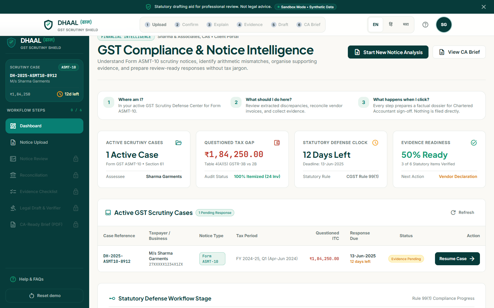
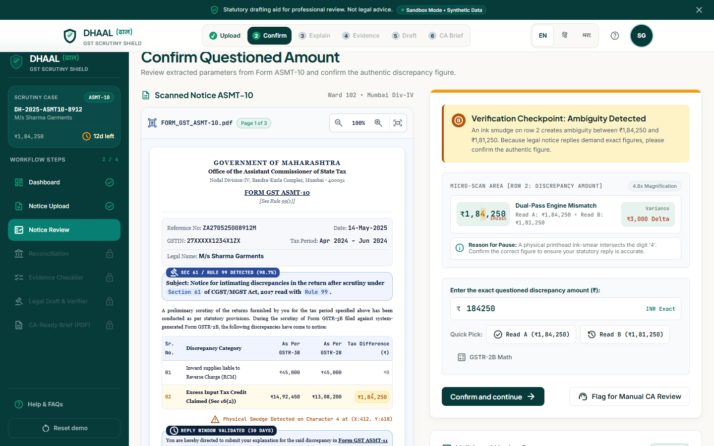
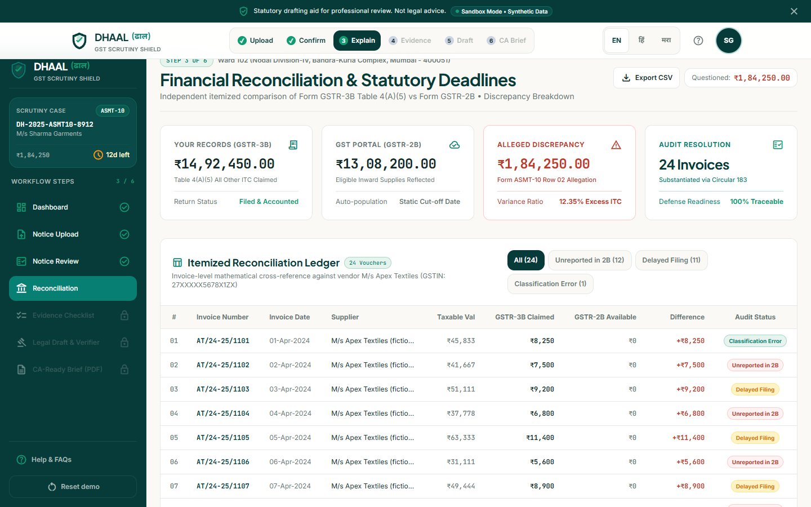
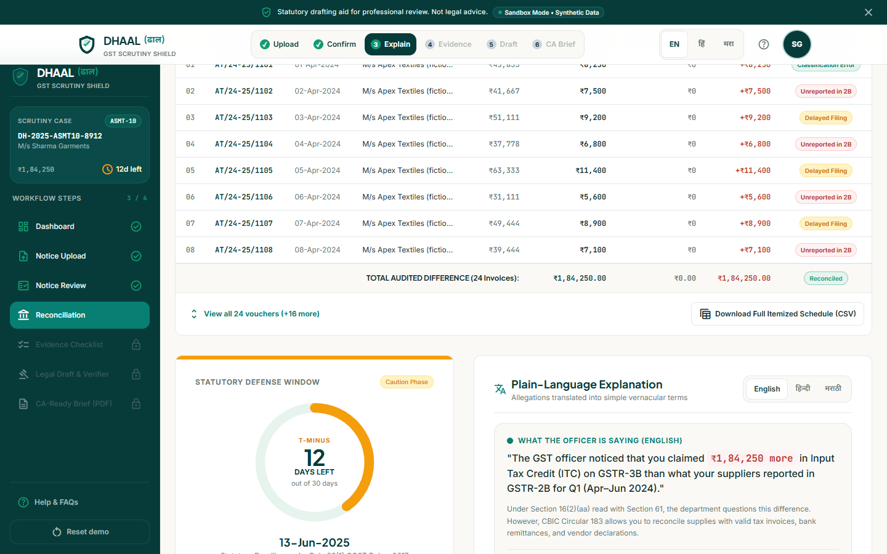
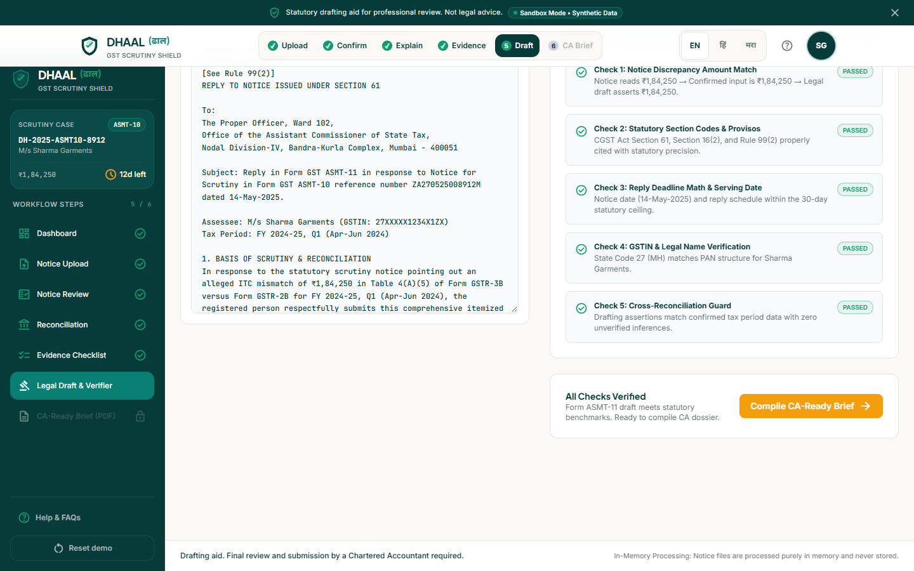
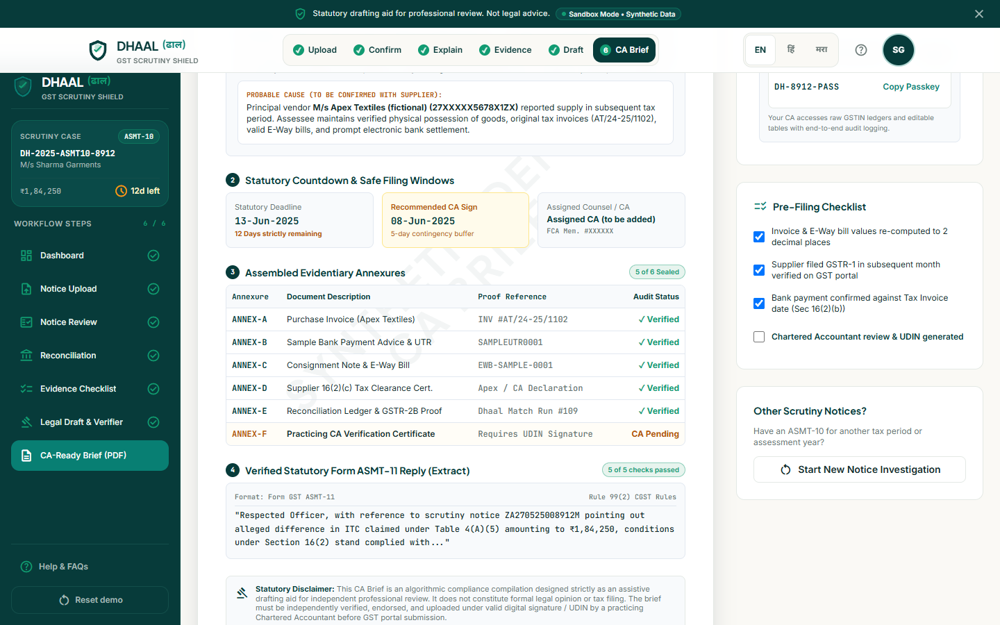
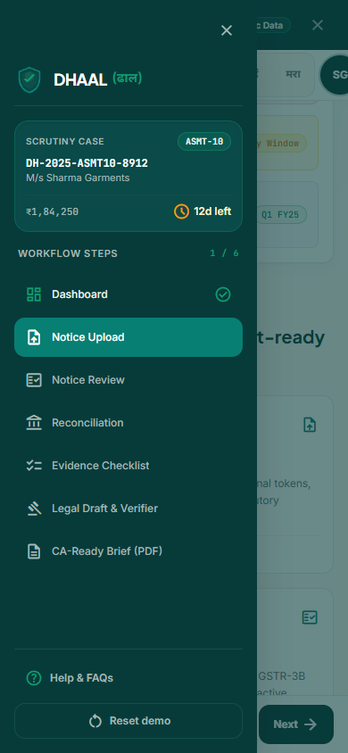
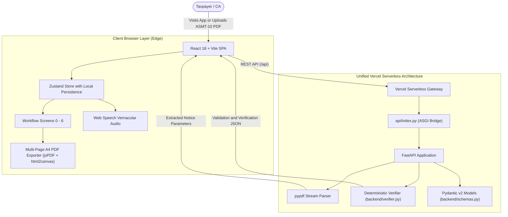

<p align="center">
  
</p>

# DHAAL (ढाल) — GST Scrutiny Notice Shield (Form ASMT-10)

> **Statutory decision-support and response preparation workspace for Chartered Accountants, tax practitioners, and Indian SMEs. Not legal advice. Nothing is filed directly without professional sign-off.**

[](https://dhaal-gst-sheild.vercel.app)
[](./LICENSE)
[](https://react.dev)
[](https://fastapi.tiangolo.com)
[](https://github.com/nikhilkunte645-maker/DHAAL-GST-SHEILD/actions)

DHAAL (ढाल — *Shield*) is a specialized financial compliance platform designed to help Indian Chartered Accountants and business owners navigate scrutiny notices issued under **Section 61 of the Central Goods and Services Tax (CGST) Act, 2017** (Form GST ASMT-10). It parses notice parameters, mathematically audits discrepancies, tracks statutory deadlines under Rule 99(1), organizes evidentiary binders under Section 16(2), and generates audit-ready reply drafts in minutes.

---

## 🎯 Quick Links
* **Official Production App:** [https://dhaal-gst-sheild.vercel.app](https://dhaal-gst-sheild.vercel.app)
* **Production API Endpoint:** [https://dhaal-gst-sheild.vercel.app/api](https://dhaal-gst-sheild.vercel.app/api)
* **Judges' 5-Minute Demo Walkthrough:** [🎯 Read HACKATHON_DEMO_SCRIPT.md](./HACKATHON_DEMO_SCRIPT.md)
* **Technical Judge Q&A Defense:** [⚖️ Read HACKATHON_TECHNICAL_QA.md](./HACKATHON_TECHNICAL_QA.md)
* **Verified Benchmarks & Metrics:** [📊 Read HACKATHON_METRICS.md](./HACKATHON_METRICS.md)
* **Deployment & Operations Guide:** [📖 Read DEPLOYMENT_GUIDE.md](./DEPLOYMENT_GUIDE.md)

---

## 🛡️ Why Dhaal Stands Out (Market Differentiators)
Unlike generic document parsers or basic AI wrappers, Dhaal provides a production-grade statutory compliance shield through:
* **Deterministic + Probabilistic Hybrid Validation:** Combines flexible generative reasoning with strict Python regex/deterministic math checks to eliminate financial hallucinations.
* **The DHAAL Evidence Graph (DEG):** Interactive bipartite directed acyclic graph binding notice allegations $\to$ 24 invoices $\to$ bank RTGS UTRs $\to$ Section 16(2) statutory legs.
* **Statutory Section Mapping:** Automatically maps identified discrepancies directly to **Section 61 of the CGST Act and Rule 99(1)**.
* **Section 170 CGST Precision Rounding:** Strict Decimal `ROUND_HALF_UP` statutory rounding eliminates floating-point drift.
* **CA-Ready Structured Briefs:** Packages outputs into professional audit summaries optimized for client review and Chartered Accountant handoff.
* **Zero-Retention Privacy Sandbox:** Enterprise-grade security processing sensitive taxpayer records strictly in-memory without persistent third-party database storage.

---

## Why DHAAL? — How Are We Different?

| Existing Solution | What DHAAL Does Differently |
|---|---|
| ClearTax — GST compliance and tax workflows | Focuses on connecting individual scrutiny allegations with supporting evidence and evidence gaps. |
| Tally — Accounting and financial records | Goes beyond accounting records to organize scrutiny allegations, reconciliation findings, and supporting evidence. |
| Zoho Books — Business accounting and financial management | Focuses specifically on the GST scrutiny-response workflow rather than general business accounting. |
| Excel / Manual Workflows | Brings notice analysis, deterministic reconciliation, Evidence Graph, and AI-assisted response preparation into one connected workflow. |

**DHAAL's difference is its evidence-first approach: it connects GST scrutiny allegations to verifiable records, identifies missing evidence, and helps professionals prepare structured responses with deterministic analysis and human review.**

---

## ⚠️ The Problem: GST Scrutiny Anxiety in India

When an Indian small business receives a Form GST ASMT-10 scrutiny notice:
1. **Strict 30-Day Statutory Countdown:** Under **Section 61 and Rule 99(1) of the CGST Rules, 2017**, the taxpayer must furnish an explanation within 30 days (or permitted extension). Under Rule 99(3), if no satisfactory explanation is furnished, the proper officer may initiate appropriate proceedings such as audit (Section 65/66), inspection (Section 67), or tax determination proceedings under Section 73 or Section 74 (distinct from Section 64 summary assessment; provisional bank attachment is separately governed by Section 83).
2. **Mathematical Complexity:** Scrutiny notices highlight arithmetic variances between self-assessed monthly returns (**GSTR-3B Table 4(A)(5)**) and auto-populated supplier statements (**GSTR-2B**), frequently involving dozens of individual invoices with timing differences.
3. **Severe Panic & Jargon Overload:** Small business owners panic over large headline figures, while CAs spend hours manually extracting DINs, verifying tax periods, and drafting repetitive legal explanations.

---

## 👥 Target Users

* **Chartered Accountants & GST Practitioners:** Seeking an automated workspace to ingest client ASMT-10 notices, run itemized 24-invoice reconciliations, and generate structured statutory dossiers.
* **SME Business Owners & Accountants:** Requiring plain-language, jargon-free explanations in English, Hindi, and Marathi to understand what the tax officer is questioning and what documents are required.

---

## 🖼️ Application Walkthrough & Verified Screenshots

| Welcome & Case Intelligence Dashboard | Notice Ingestion & Parameter Review |
| :---: | :---: |
|  |  |
| *Active scrutiny ledger, Mercury-style metrics & 6-stage case progress* | *Structured taxpayer details, DIN validation & discrepancy confirmation* |

| Financial Reconciliation Ledger (24 Invoices) | Statutory Deadline Dial & Audio Explainer |
| :---: | :---: |
|  |  |
| *Itemized invoice reconciliation, status chips & 1-click CSV export* | *Rule 99(1) 30-day countdown & Web Speech audio readout in 3 languages* |

| Evidence Checklist & WhatsApp Generator | Factual Verifier & Statutory Reply Editor |
| :---: | :---: |
|  |  |
| *Section 16(2) statutory matrix with 1-click supplier WhatsApp prompts* | *Real-time dual-pane editor verifying cited amounts, dates & circulars* |

| CA-Ready Dossier & Multi-Page A4 PDF | Responsive Mobile Experience |
| :---: | :---: |
|  |  |
| *Print-ready legal brief with multi-page A4 PDF export (zero clipping)* | *390px mobile layout with touch targets >= 44px and zero overflow* |

---

## ✨ Core Features

1. **Welcome & Case Intelligence Dashboard (`#dashboard`):** Central command hub showing active case references (`DH-2025-ASMT10-8912`), questioned tax gaps, remaining defense days, linear stage tracker, and educational knowledge cards.
2. **Stream-Based In-Memory Notice Parsing:** PDF parsing using `pypdf` streams that extracts Document Identification Numbers (DIN), Reference IDs, taxable periods, and discrepancy amounts without disk persistence.
3. **Itemized 24-Invoice Reconciliation Engine:** Granular invoice audit categorizing differences into *Unreported in 2B*, *Delayed Filing*, *Rate Mismatches*, and *Matched* with one-click CSV export for Excel and Tally.
4. **Statutory Defense Clock (Rule 99(1)):** Animated countdown dial tracking the mandatory 30-day defense window with recommended CA sign-off dates (5 days prior to statutory deadline).
5. **Section 16(2) Evidentiary Binder:** Period-aware statutory evidence checklist (Tax Invoices, GSTR-2B status, Bank Payment Vouchers, Supplier Confirmation, E-Way bills, and CA Certification with UDIN) with an automated supplier inquiry generator.
6. **Deterministic Factual Verifier:** Real-time draft analysis checking that every cited rupee amount, tax period, invoice number, and legal circular in the draft matches confirmed notice parameters.
7. **Multi-Page A4 PDF Dossier:** Client-side vector-accurate PDF export engine generating 2-page A4 dossiers in English, Hindi, and Marathi with zero right-edge clipping.
8. **Trilingual Support (EN / HI / MR):** Full vernacular UI and Web Speech audio synthesizers in English, Hindi, and Marathi, with strict Devanagari line-height formatting ($\ge 1.75$).

---

## 🏗️ Architecture Overview



---

## 💻 Technology Stack

| Layer | Technology | Purpose |
| :--- | :--- | :--- |
| **Frontend Framework** | React 18.3.1 | Component-based reactive user interface |
| **Build Tooling** | Vite 5.4.21 | Sub-second HMR & high-performance production bundling |
| **Language** | TypeScript 5.4.5 | Strict static typing and interface contracts |
| **State Management** | Zustand 4.5.2 | Lightweight reactive state with localStorage persistence |
| **Styling & Tokens** | Tailwind CSS 3.4.3 | FinTech token architecture (Deep Teal, Emerald, Soft Mint) |
| **PDF Generation** | jsPDF 2.5.1 + html2canvas 1.4.1 | Section-sliced multi-page A4 document export |
| **Typography** | `@fontsource` | Plus Jakarta Sans, Inter, JetBrains Mono, Noto Sans Devanagari |
| **Backend Framework** | Python 3.11+, FastAPI 0.115+ | High-performance asynchronous REST API |
| **Data Validation** | Pydantic v2.10+ | Strict request/response schema modeling |
| **Document Parsing** | PyPDF 5.0+ | In-memory stream extraction for notice parameters |
| **Deployment Platform** | Vercel Unified Serverless | Combined static edge hosting + Python serverless backend |

---

## 📁 Repository Directory Structure

```
DHAAL/
├── api/                        # Vercel Serverless Python entrypoint
│   ├── index.py                # ASGI serverless bridge to backend.main:app
│   └── requirements.txt        # Serverless Python dependencies
├── backend/                    # Core Python FastAPI application
│   ├── main.py                 # FastAPI application routes, CORS & middleware
│   ├── schemas.py              # Pydantic v2 request/response models
│   ├── verifier.py             # Deterministic statutory fact-checker & math engine
│   ├── test_api.py             # Pytest API integration test suite
│   ├── tests/                  # Pytest upload and verifier unit test suites
│   └── requirements.txt        # Backend dependencies
├── docs/                       # Project documentation & screenshots
│   └── screenshots/            # Verified real-browser application screenshots
├── src/                        # React 18 TypeScript application source
│   ├── components/             # Reusable UI primitives & layout elements
│   │   ├── BrandLogo.tsx       # Precision geometric shield SVG logo
│   │   ├── Header.tsx          # Navigation header with language & case info
│   │   ├── Sidebar.tsx         # Deep teal desktop/mobile navigation sidebar
│   │   └── ui/                 # Card, Button, Badge atomic components
│   ├── data/                   # Canonical demo case & 24-invoice audit ledger
│   ├── lib/                    # INR currency formatting & test helpers
│   ├── screens/                # Core user journey views
│   │   ├── DashboardScreen.tsx # Step 0: Welcome & Case Intelligence Dashboard
│   │   ├── Screen1Upload.tsx   # Step 1: In-memory notice PDF uploader
│   │   ├── Screen2ConfirmPause.tsx # Step 2: Confirm & Pause extraction review
│   │   ├── Screen3ExplainerDeadlines.tsx # Step 3: Reconciliation & deadlines
│   │   ├── Screen4EvidenceChecklist.tsx # Step 4: Section 16(2) evidence matrix
│   │   ├── Screen5DraftVerifier.tsx     # Step 5: Draft editor & factual verifier
│   │   └── Screen6CaReadyBrief.tsx      # Step 6: CA Brief & multi-page A4 PDF export
│   ├── store/                  # Zustand global application state
│   ├── mockApi.ts              # Central REST API client with local/production auto-routing
│   ├── App.tsx                 # Root application router & layout container
│   ├── main.tsx                # React DOM entrypoint & font providers
│   └── index.css               # Design system variables & Devanagari font rules
├── .github/workflows/          # GitHub Actions CI workflow
│   └── ci.yml                  # Automated build, test, and typecheck pipeline
├── .env.example                # Safe environment variable template
├── DEPLOYMENT_AUDIT_REPORT.md  # Detailed infrastructure & hosting audit
├── DEPLOYMENT_GUIDE.md         # Step-by-step production promotion & rollback manual
├── Procfile                    # Standalone container process definition (Render/Railway)
├── package.json                # Node dependencies and project scripts
├── tailwind.config.ts          # FinTech design tokens & typography configuration
├── vercel.json                 # Vercel deployment, rewrite, and build rules
└── vite.config.ts              # Vite bundler configuration & path aliases
```

---

## 🚀 Local Installation & Setup

### Prerequisites
* **Node.js**: v18.0.0 or higher (v20+ recommended)
* **Python**: v3.10 or higher (v3.11 recommended)
* **Git**: Installed and configured

### 1. Clone the Repository
```bash
git clone https://github.com/nikhilkunte645-maker/DHAAL-GST-SHEILD.git
cd DHAAL
```

### 2. Configure Environment Variables
```bash
# Copy the template
cp .env.example .env.local
```
*(For local development, the defaults in `.env.example` target `http://localhost:8001` automatically without modification.)*

### 3. Backend Setup & Startup
In your first terminal:
```bash
# Install Python dependencies
pip install -r requirements.txt

# Start the FastAPI server on port 8001
uvicorn backend.main:app --host 0.0.0.0 --port 8001 --reload
```
Verify backend health: open `http://localhost:8001/api` in your browser. You should receive:
```json
{"status":"online","system":"Dhaal Backend","version":"1.0.0"}
```

### 4. Frontend Setup & Startup
In a second terminal:
```bash
# Install Node dependencies
npm install

# Start the Vite development server on port 3001
npm run dev
```
Open `http://localhost:3001` in your browser. The frontend will automatically connect to your local backend.

---

## 🧪 Testing & Verification Commands

DHAAL maintains automated test suites covering TypeScript compilation, frontend unit tests, and backend FastAPI logic.

### Run All Tests:
```bash
# 1. TypeScript Static Typecheck (0 errors)
npx tsc --noEmit

# 2. Frontend Unit Tests (83/83 passing across 7 test suites)
npm test

# 3. Production Bundle Build (0 errors, ~327 kB gzip JS)
npm run build

# 4. Backend Integration & Unit Tests (62/62 passing across 8 test modules)
python -m pytest backend/

# 5. End-to-End Multi-Page PDF & Touch Target Verification (requires 'npm run preview' in separate terminal)
node scripts/test_pdf_and_verification.js
```

---

## 📡 API Endpoint Reference

| Method | Endpoint | Description |
| :--- | :--- | :--- |
| `GET` | `/api` | System health check and status verification |
| `POST` | `/api/notice/upload` | Multipart PDF stream parser extracting notice parameters |
| `POST` | `/api/verify/draft` | Deterministic statutory fact-checker validating defense draft |
| `GET` | `/api/explain/{lang}` | Plain-language statutory explainer (`en`, `hi`, `mr`) |
| `POST` | `/api/brief/generate` | Synthesizes formal CA Brief dossier JSON |
| `GET` | `/api/notices/{case_id}` | Retrieves canonical case parameters |
| `POST` | `/api/notices/{case_id}/confirm` | Confirms or edits disputed tax discrepancy amounts |
| `POST` | `/api/reconciliation/run` | Two-tier exact & fuzzy reconciliation engine (Section 170 rounding) |
| `GET` | `/api/evidence/{case_id}/graph` | Directed Acyclic Graph (DAG) of evidence and Section 16(2) compliance |
| `GET` | `/api/evidence/{case_id}/scorecard` | Evidence Completeness Indicator (ECI) scorecard breakdown |
| `POST` | `/api/circular-183/assess` | Assesses CBIC Circular 183 & 193 statutory applicability and conditions |
| `GET` | `/api/evidence/{case_id}/graph` | Retrieves bipartite Evidence Graph topology and node links |
| `GET` | `/api/evidence/{case_id}/scorecard` | Section 16(2) compliance matrix and evidentiary strength score |

---

## 🔒 Security & Privacy Guarantees

* **Zero-Storage Ephemeral Processing:** Uploaded notice PDFs are processed purely in ephemeral RAM streams via `pypdf`. Neither notice files, vendor invoice details, nor business financials are stored on persistent database disks.
* **Deterministic Verification (No AI Hallucination):** Tax calculations, invoice reconciliations, and statutory deadlines are computed using deterministic mathematical algorithms—guaranteeing zero fabricated citations or tax numbers.
* **Client-Side Secret Isolation:** No private API keys or database connection strings exist in client bundles. All `.env*` files are strictly git-ignored.

---

## ⚖️ Statutory Limitations & Disclaimer

> **Important Statutory Notice:** DHAAL is an automated compliance decision-support and drafting tool designed to assist qualified Chartered Accountants, tax advocates, and business owners. **It does not provide formal legal advice, nor does it establish an attorney-client relationship.** All generated briefs, reconciliation schedules, and reply drafts must be reviewed and signed off by a certified Chartered Accountant or legal counsel before statutory submission on the official GST Portal. DHAAL does not file returns or responses directly to government servers.

---

## 📄 License

This project is licensed under the [MIT License](./LICENSE).
