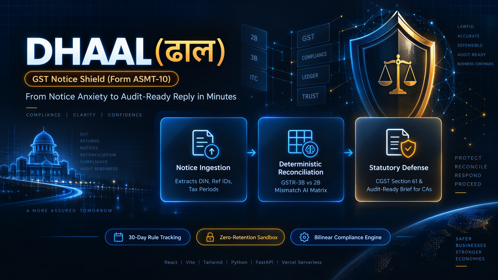

# Dhaal (ढाल) — GST Scrutiny Notice Shield (Form ASMT-10)

[](https://dhaal-gst-sheild.vercel.app)
[](./LICENSE)
[](https://fastapi.tiangolo.com)
[](https://react.dev)
[](https://www.typescriptlang.org)

> **Statutory drafting aid for professional review. Not legal advice. Final review and submission by a Chartered Accountant required.**

**Dhaal (ढाल)** is a specialized compliance assistant designed to help Indian MSMEs and Chartered Accountants rapidly analyze, verify, and formulate statutory replies to **Form GST ASMT-10** scrutiny notices issued under **Section 61 of the CGST Act, 2017** read with **Rule 99(1)**.

---

## 🚀 Live Production URL & Demo

- **Official Live Application:** [https://dhaal-gst-sheild.vercel.app](https://dhaal-gst-sheild.vercel.app)
- **Judges' Walkthrough Guide:** [🎯 3-Minute Hackathon Demo Script](./DEMO.md)

---

## 🎯 The Problem

1. **Short Statutory Response Window:** Section 61 scrutiny notices mandate a formal written reply within **30 days**. Unanswered notices automatically escalate to summary assessment orders under Section 73 or Section 74, carrying severe interest liabilities and penalties.
2. **Complex ITC Reconciliations:** Taxpayers struggle to manually reconcile Table 4(A)(5) "All other ITC" claimed in GSTR-3B against auto-populated supplier invoices in GSTR-2B.
3. **Panic & Misinterpretation:** Taxpayers frequently mistake an ASMT-10 scrutiny notice for an adjudicated tax demand order, resulting in panic rather than structured evidence assembly.

---

## 🛡️ Key Features

- **In-Memory PDF Notice Ingestion:** Parses physical text-searchable ASMT-10 PDF documents to dynamically extract Notice Reference IDs, GSTIN, CGST Sections, Tax Periods, and Questioned Discrepancy Amounts without retaining files on disk.
- **Deterministic Statutory Verifier (Dual-Layer):** Cross-verifies legal draft responses against confirmed discrepancy figures, statutory sections (Section 61, Section 16(2)), and calendar limitation deadlines using deterministic Python rules—**100% hallucination-free**.
- **Multilingual Plain-Language Explanations:** Translates complex statutory scrutiny terms into plain English, Hindi (हिंदी), and Marathi (मराठी) to clarify that ASMT-10 is an inquiry, not a tax demand.
- **Statutory Evidence Checklist:** Pre-populates statutory documentation requirements (tax invoices under Sec 16(2)(a), bank RTGS/NEFT payment proofs under Sec 16(2) second proviso, E-way bills, and Circular 183 supplier declarations).
- **CA-Ready Brief Synthesizer:** Generates a structured defense memo and reconciliation brief ready for Chartered Accountant sign-off with SHA-256 verification hash.

---

## 🏗️ Architecture


---

## 💻 Tech Stack

- **Frontend:** React 18, Vite, TypeScript, Tailwind CSS, Zustand, Vitest
- **Backend:** Python 3.12, FastAPI, Pydantic v2, PyPDF, Uvicorn, Pytest
- **Deployment:** Unified Serverless Monorepo deployed on Vercel (`vercel.json`)

---

## 📁 Project Structure

```text
DHAAL/
├── api/                                    # Vercel Serverless Python entrypoints
│   ├── index.py                            # ASGI root handler mounting backend.main:app
│   └── requirements.txt                    # Serverless runtime Python dependencies
├── backend/                                # FastAPI application layer
│   ├── main.py                             # API router & physical PDF parsing endpoints
│   ├── verifier.py                         # Deterministic dual-layer verification engine
│   ├── schemas.py                          # Pydantic v2 validation models
│   ├── tests/                              # Pytest test suite (upload & verification)
│   ├── requirements.txt                    # Production backend dependencies
│   └── requirements-dev.txt                # Developer test dependencies (pytest, httpx)
├── src/                                    # React 18 + TypeScript frontend
│   ├── components/                         # Reusable UI components (Header, Sidebar, Modals)
│   ├── screens/                            # 6-stage compliance workflow screens
│   ├── store/                              # Global Zustand state management
│   ├── mockApi.ts                          # REST API client with same-origin relative routing
│   └── lib/                                # Formatting, deadline math, and SHA-256 hashing
├── docs/screenshots/                       # Desktop and mobile UI walkthrough captures
├── source/stitch_dhaal_gst_notice_assistant/ # Figma / Stitch design system reference screens
├── vercel.json                             # Vercel deployment rewrites (/api -> api/index.py)
├── netlify.toml                            # Alternative static/edge configuration
├── Procfile                                # Alternative container/Heroku process declaration
├── .env.example                            # Sample environment variables reference
└── README.md                               # Project documentation
```

*Note on alternative configs:* `Procfile` and `netlify.toml` are maintained for multi-cloud deployment compatibility (e.g. Docker/Heroku/Render containers or Netlify previews), while `vercel.json` provides the primary single-deployment serverless production environment.

---

## 🔒 Privacy & Data Handling (Audited)

- **Purely In-Memory Processing:** Uploaded notices are read directly into ephemeral memory (`io.BytesIO`) for parsing and validation.
- **Zero Disk Retention:** No uploaded documents, temporary files, or parsed records are written to disk, databases, or cloud storage buckets.
- **Zero Third-Party LLM Transmission:** Reconciliation checks, number verifications, and draft mismatch audits are computed entirely with local deterministic Python algorithms—no taxpayer data is transmitted to external AI APIs.
- **Standard Console Logging:** Logs are restricted to basic request metadata (HTTP path, response code, and latency) printed to stdout/stderr. No taxpayer PII is retained in persistent log files.

---

## ⚠️ Known Limitations

- **Text-Layer PDFs Only:** Notice parsing relies on digital text layers within PDFs. Scanned image-only PDFs without OCR text layers are safely rejected with HTTP 422, prompting the user to upload a text-searchable document.
- **Serverless Request Size Limit:** Upload payloads are capped at **4 MB** to operate safely within Vercel's serverless function request body ceiling (4.5 MB).
- **Execution Timeout:** Vercel serverless requests time out after 10 seconds on standard tiers (all in-memory parsing executes within 50ms).

---

## 🗺️ Roadmap

1. **Async OCR Processing:** Background Celery/Redis queue with Optical Character Recognition (Tesseract / Vision AI) for smudged or physical paper notices.
2. **Client Vault with Opt-In Persistence:** End-to-end encrypted local/cloud storage for Chartered Accountants managing multi-year client scrutiny portfolios.
3. **Automated GSTR-2B JSON Import:** Direct JSON ingestion from the GST Portal for automatic reconciliation against inward supply invoices.

---

## 🚀 Local Development Setup

### 1. Prerequisites
- **Node.js** v18+ & **npm** v9+
- **Python** 3.10+ & **pip**

### 2. Backend Setup
```bash
# Navigate to backend directory
cd backend

# (Optional) Create virtual environment
python -m venv venv
# Windows:
.\venv\Scripts\activate
# Linux/macOS:
source venv/bin/activate

# Install runtime dependencies
pip install -r requirements.txt

# Install test dependencies
pip install -r requirements-dev.txt

# Start local FastAPI server on port 8001
uvicorn main:app --port 8001 --reload
```

### 3. Frontend Setup
```bash
# In the repository root
npm install

# Start Vite dev server on port 3001
npm run dev
```
Open [http://localhost:3001](http://localhost:3001) in your browser.

### 4. Running Tests
```bash
# Frontend Unit Tests (Vitest)
npm test

# Backend Tests (Pytest)
python -m pytest backend/tests -v
```

---

## 📸 Screenshots

*(UI walkthrough captures of the 6-stage compliance workflow)*

| Stage 1: Notice Upload & Stream Parsing | Stage 2: Pause & Confirm Scanned Amount |
| :---: | :---: |
|  |  |

| Stage 3: Statutory Deadlines & Explainer | Stage 4: Evidence Checklist & Ledger |
| :---: | :---: |
|  |  |

| Stage 5: Deterministic Draft Verifier | Stage 6: CA-Ready Brief & Export |
| :---: | :---: |
|  |  |

---

## ⚖️ Legal Disclaimer

*Dhaal is an assistive compliance drafting aid designed for pre-submission analysis by businesses and Chartered Accountants. It does not file any documents with the GST Common Portal and does not constitute formal legal counsel.*

